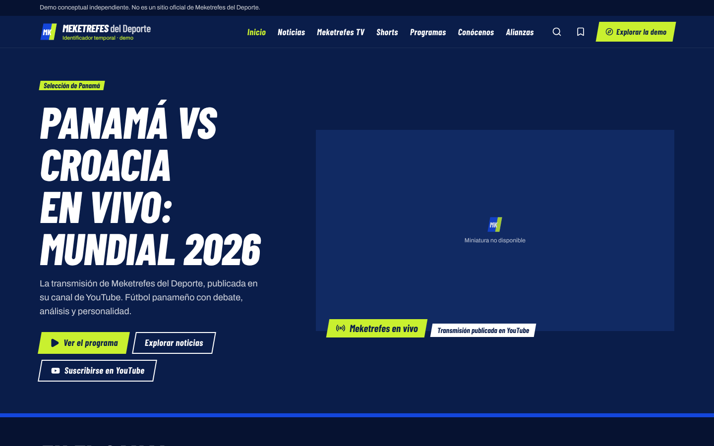
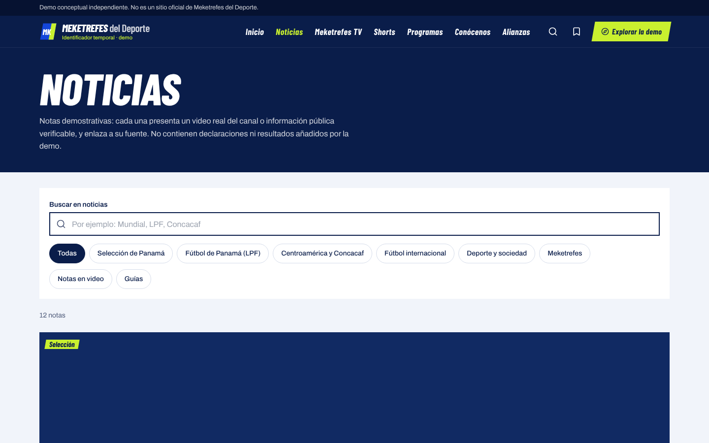
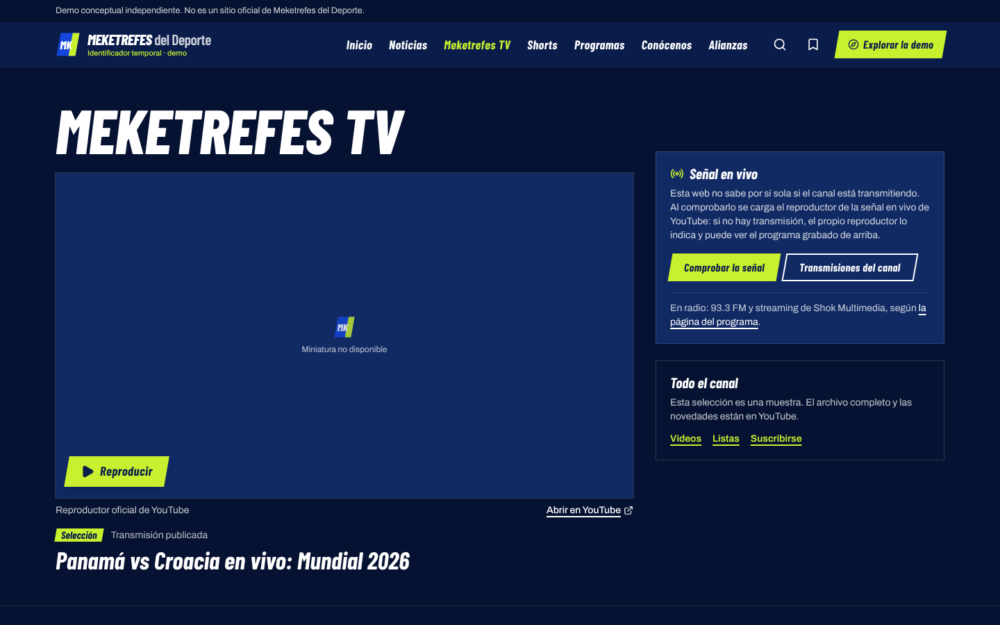
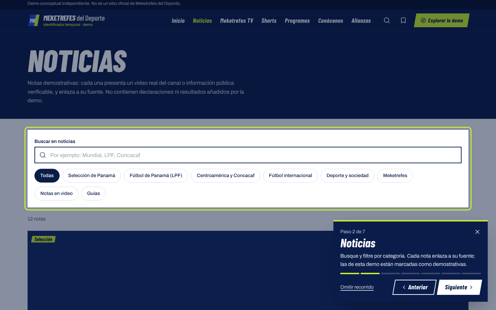
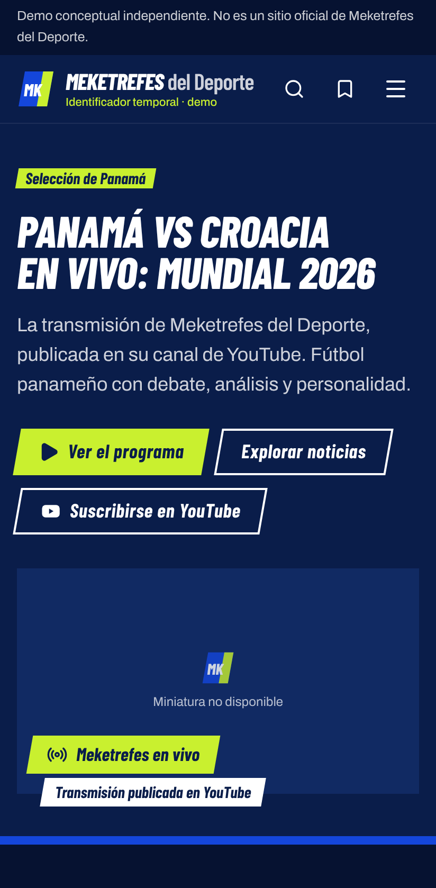
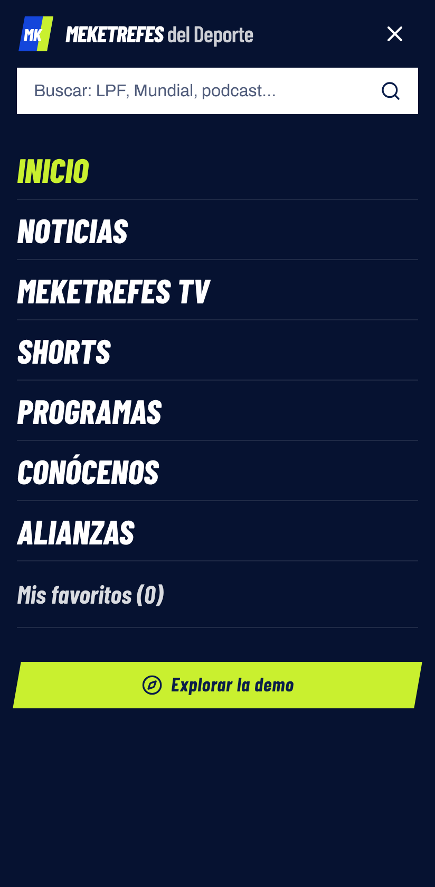

# Meketrefes del Deporte · Demo de portal web

> **Demo conceptual independiente. No es un sitio oficial de Meketrefes del Deporte.**

Propuesta de portal digital para **Meketrefes del Deporte**, medio de comunicación deportiva de Panamá: fútbol panameño,
Selección de Panamá, LPF, Centroamérica y Concacaf, debate, transmisiones, podcasts y Shorts.
Es una web funcional (React + Vite + TypeScript) pensada para GitHub Pages, construida con **videos reales del canal oficial
de YouTube**, reproducidos con el reproductor oficial.

**Demo:** https://charrixxz23.github.io/meketrefes-del-deporte-demo/ *(dirección prevista; activa cuando el flujo de GitHub Pages termine)*



## Concepto y desarrollo

Repositorio de demostración desarrollado como una propuesta tecnológica independiente para explorar cómo Meketrefes del Deporte podría consolidar su presencia digital mediante un portal web.

Desarrollo de la demo: [charrixxz23](https://github.com/charrixxz23). El desarrollador no forma parte del medio ni habla en su nombre.

## Funcionalidades

| Sección | Qué hace |
|---|---|
| **Inicio** | Portada con un video real del canal, accesos a programa, noticias y YouTube; carril de videos, Selección de Panamá, noticias, fútbol nacional e internacional, debate, clips y Shorts, programas, comunidad y alianzas. |
| **Noticias** | Nota destacada, cuadrícula, filtros por categoría y tipo, buscador, vista de nota con reproductor, fuentes con fecha de consulta y notas relacionadas. |
| **Meketrefes TV** | Video destacado, comprobación de señal en vivo a petición, carriles por formato (transmisiones, Show de la LPF, análisis, podcasts, entrevistas, mejores momentos), lista temática y archivo filtrable. |
| **Shorts** | Cuadrícula vertical, filtro por categoría, visor vertical con siguiente/anterior por botón, teclado o deslizamiento, y enlace al original. |
| **Programas** | Página por formato con sus videos. Horario y presentadores solo si una fuente pública los confirma. |
| **Conócenos** | Qué es el medio, qué produce, su enfoque, plataformas oficiales, galería del canal y aviso de la demo. |
| **Alianzas** | Espacios comerciales conceptuales («Disponible», «Espacio demostrativo»), integraciones, colaboraciones y formulario que valida y prepara el mensaje sin fingir un envío. |
| **Transversal** | Búsqueda global sin tildes, favoritos guardados en el navegador, menú móvil, recorrido «Explorar la demo» de 7 pasos, estados de carga y de error, 404 propia, accesible con teclado, favicon, manifiesto e imagen para redes. |

## Capturas

| | |
|---|---|
|  |  |
|  |  |
|  |  |

> Las capturas se tomaron en un entorno sin acceso a los servidores de YouTube, por eso aparecen marcadores en lugar de
> miniaturas. En el sitio publicado se ven las miniaturas oficiales. Para regenerarlas: `node scripts/screenshots.mjs <URL>`.

## Tecnologías

React 18 · Vite 6 · TypeScript (estricto) · Tailwind CSS 3 · React Router 6 · Lucide · Barlow Condensed y Archivo (`@fontsource`) ·
Vitest + Testing Library · Playwright · GitHub Actions + GitHub Pages.

Sin backend, sin claves de API y sin servicios de pago.

## Instalación

```bash
git clone https://github.com/charrixxz23/meketrefes-del-deporte-demo.git
cd meketrefes-del-deporte-demo
npm ci
npm run dev        # http://localhost:5173/meketrefes-del-deporte-demo/
```

| Comando | Para qué |
|---|---|
| `npm run build` | Compila en `dist/` (con `404.html` para las rutas de GitHub Pages). |
| `node scripts/serve-pages.mjs` | Sirve `dist/` igual que GitHub Pages. |
| `npm run typecheck` · `npm test` | Tipos y pruebas unitarias. |
| `npm run test:e2e` | Pruebas de navegador (requiere `npx playwright install chromium`). |

Despliegue paso a paso: [docs/deployment.md](docs/deployment.md).

## Cómo actualizar videos y contenido

Todo el contenido está en `src/data/`:

- `videos.ts`: videos, Shorts, listas y video de portada.
- `articles.ts`: notas.
- `programs.ts`: programas.
- `site.ts`: redes, enlaces, correo comercial y aviso.
- `partnerships.ts`: espacios comerciales.

Para añadir un video basta con su identificador y su título exacto; `npm test` valida el catálogo.
Detalle y propuesta de sincronización automática con YouTube: [docs/content-sources.md](docs/content-sources.md).

## Arquitectura

```
src/
├── data/        Contenido tipado (fuente única; sustituible por un CMS o API)
├── utils/       YouTube (URLs oficiales), búsqueda y catálogo, texto
├── hooks/       Favoritos (localStorage tolerante a fallos), metadatos de página
├── components/  Cabecera, pie, reproductor diferido, miniaturas, tarjetas, recorrido, estados
├── layouts/     Estructura común, manejo de errores y carga diferida por ruta
├── pages/       Una página por ruta (cargadas bajo demanda)
└── styles/      Variables de la paleta y componentes CSS
```

- **Rutas**: `createBrowserRouter` con `basename` tomado de `BASE_PATH`.
- **Rendimiento**: código dividido por página, reproductores que solo se cargan al pulsar, miniaturas diferidas, fuentes locales en subconjunto latino.
- **Escalabilidad**: las páginas leen de `src/data`; reemplazar esos módulos por llamadas a un CMS (Sanity, Strapi, WordPress sin cabeza) o a un backend no requiere cambiar los componentes.

Sistema visual: [docs/design-system.md](docs/design-system.md).

## Limitaciones

- No se pudieron verificar **fechas de publicación**: la web no muestra fechas ni afirma qué es lo más reciente.
- Solo **2 Shorts** verificados; la sección enlaza al resto en YouTube.
- **Instagram y X** bloquean la consulta automática: solo hay enlaces a los perfiles.
- **Paleta** basada en la referencia del brief; falta ajustarla con los archivos oficiales.
- **Logotipo**: se usa un identificador temporal.
- **Formulario** sin servicio de recepción (no hay correo comercial verificado).
- En GitHub Pages las rutas internas responden con código 404 aunque cargan bien (ver `deployment.md`).

Detalle de lo verificado y lo pendiente: [docs/testing.md](docs/testing.md).

## Mejoras futuras

1. Sincronización programada con la YouTube Data API desde GitHub Actions (clave como secreto, nunca en el navegador).
2. CMS para que el equipo publique notas propias, con autores y fechas reales.
3. Instagram Graph API con la cuenta profesional del medio.
4. Agenda de transmisiones y programas confirmada por el equipo.
5. Boletín, notificaciones y analítica respetuosa con la privacidad.
6. Dominio propio y pre-renderizado de rutas para SEO.

## Licencia y avisos

Código bajo licencia MIT ([LICENSE](LICENSE)). Marcas, nombres, videos y miniaturas pertenecen a sus titulares:
ver [NOTICE.md](NOTICE.md).
